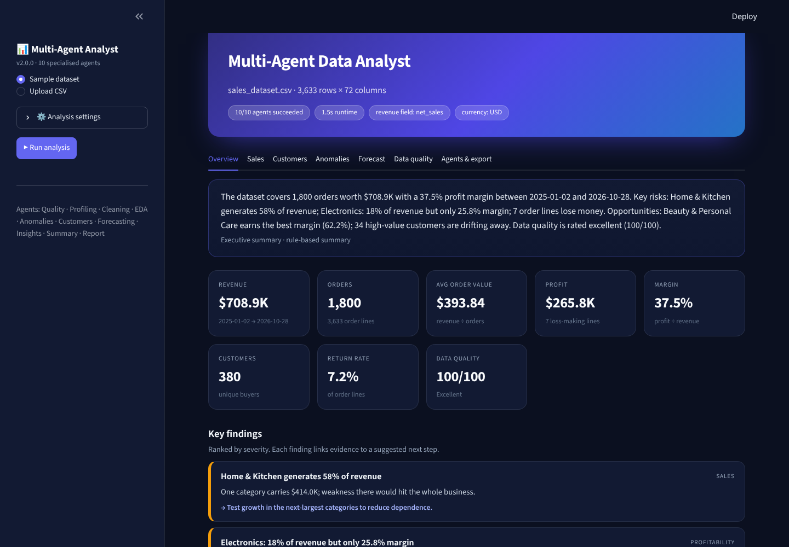
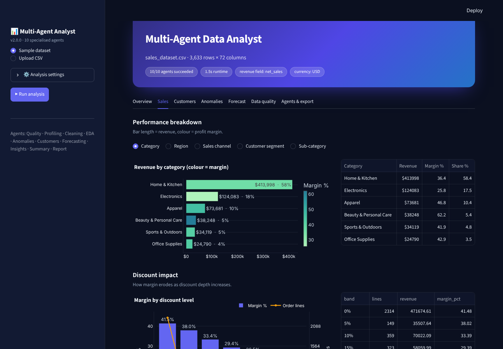
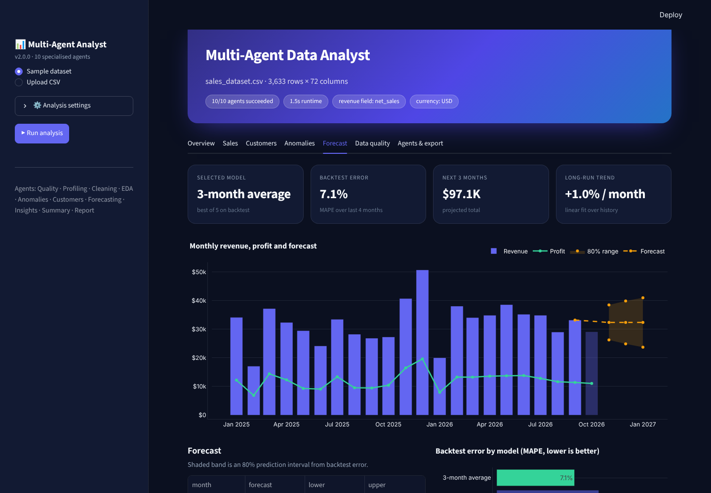

# 📊 Multi-Agent Data Analyst

A ten-agent analytics pipeline that turns a raw sales CSV into KPIs, anomaly detection, customer
segmentation, a backtested forecast and ranked business recommendations, delivered through an
interactive Streamlit dashboard, a CLI and a shareable HTML report.



<p align="center">
 
</p>

📄 Example output: [`docs/sample_report.html`](docs/sample_report.html) · 🏗️ Design notes: [`docs/architecture.md`](docs/architecture.md)

## Highlights

- **Blackboard architecture**: ten independent agents share one context; each fails in isolation and is timed.
- **Schema auto-detection**: works with `net_sales`, `sales`, `revenue`… no configuration needed.
- **Explainable anomaly detection**: Isolation Forest on business measures only (no target leakage), each
  flagged row shows *why* (robust z-scores) and is compared with any flags already in the data.
- **Customer analytics**: RFM segmentation (Champions → Lost), Pareto concentration, at-risk high-value customers.
- **Honest forecasting**: five models compete on a rolling-origin backtest, partial months are excluded, uncertainty is shown.
- **Business insights**: severity-ranked findings with evidence and a suggested next step
  (e.g. margin erosion by discount depth, revenue leakage from refunds, customer concentration risk).
- **Production habits**: 34 tests incl. real-data regression and a UI smoke test, ruff, CI matrix (3.10–3.12), Docker.
- **Optional LLM summary**: off by default; sends aggregates only, never rows.

## Quick start

```bash
pip install -r requirements.txt
streamlit run app.py                         # dashboard (auto-loads the sample dataset)
python main.py data/sample/sales_dataset.csv # CLI → writes reports/*.json + *.html
```

```bash
pip install -r requirements-dev.txt && python -m pytest -q && ruff check .
docker build -t multi-agent-data-analyst . && docker run -p 8501:8501 multi-agent-data-analyst
```

## Using it as a library

```python
from analyst import run_analysis, AnalysisConfig

ctx = run_analysis("data/sample/sales_dataset.csv", AnalysisConfig(forecast_horizon=6))
ctx.data("eda")["kpis"]            # revenue, profit, margin, AOV ...
ctx.data("insights")["insights"]   # ranked findings
ctx.results["forecasting"].status  # success | skipped | failed
```

## Project layout

```
analyst/            core package (schema, config, context, orchestrator, viz, reporting, cli)
analyst/agents/     quality · profiling · cleaning · eda · anomalies · customers · forecasting · insights · summary · report
ui/                 Streamlit styles, components and tabs
tests/              unit, real-data regression and UI smoke tests
data/sample/        sales_dataset.csv (3,633 order lines × 72 columns) + a tiny legacy sample
```

## Limitations (stated honestly)

- Forecasts come from ~20 months of history; they ignore promotions and external events.
- Insights flag patterns worth investigating; they do not prove causes.
- Agents are deterministic analytical components, not autonomous LLM agents. The optional LLM only rewrites the summary.

## License
MIT
